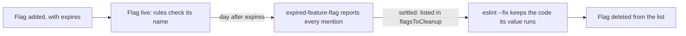

[🏠 Home](../../README.md) · [📚 Docs](../README.md) · `eslint-plugin-feature-flags`:
[🚀 Tutorial](./tutorial.md) · [🛠️ How-to](./how-to.md) · [📖 Reference](./reference.md) · **💡
Explanation**

# 💡 Explanation: `eslint-plugin-feature-flags`

Why the rules read flags the way they do. The facts they rest on are in the
[Reference](./reference.md).

## A flag is declared once, and every rule reads the same list

The flag list is a fact about the project, not about one rule. Kept in `settings["feature-flags"]`,
it is written once and every rule sees the same names and dates; a rule's own options still win, for
the rare rule that needs another list. ESLint checks a rule's options against its schema but never
checks `settings`, so the plugin checks them itself and names the key that is wrong.

## `expires` is the last day a flag may live

A date read as "the last day" means a flag is reported the day after it, never on the day the team
agreed to keep it. The day is the local one, because that is the calendar people write dates in. A
flag with no `expires` is permanent on purpose: kill switches and operations toggles are flags that
should never be removed, yet their names should still be checked.

## An expired flag is reported wherever its name appears

Removing a flag means removing every trace of it: the read, but also the analytics event that names
it, the object that lists it, the test that toggles it. So `expired-feature-flag` reports any
string, key or property with the flag's name, and the work is done when the reports are gone.

## An undeclared flag is only checked where a flag is read

Any string could look like a flag name, so `no-undefined-feature-flags` only checks a call to a
function in `identifiers`: there, a name missing from the list is a typo or a forgotten declaration,
and at runtime it reads as off. A name built at runtime, such as `isEnabled(name)`, cannot be known
before the code runs, so no rule guesses at it.

## A settled flag becomes a value, then the code simplifies around it

`cleanup-feature-flag` replaces each read with `true` or `false`, then simplifies the `if`, `? :`,
`&&` or `||` around it. The code left is what users already ran with that value, so the fix changes
no behaviour. A kept block keeps its braces when it declares `let`, `const`, `class` or `function`,
so its names cannot clash with the code around it. Imports the removed branch used stay: an unused
import is already the job of `no-unused-vars` and your bundler.

## One package, with no runtime dependencies

The plugin used to ship with `@eslint-plugin-feature-flags/core` and `/types`. They held a few
helpers that only this plugin used, so they were folded into `src/flags.ts`, and both are deprecated
on npm. A user installs one package, and ESLint is its only peer.
